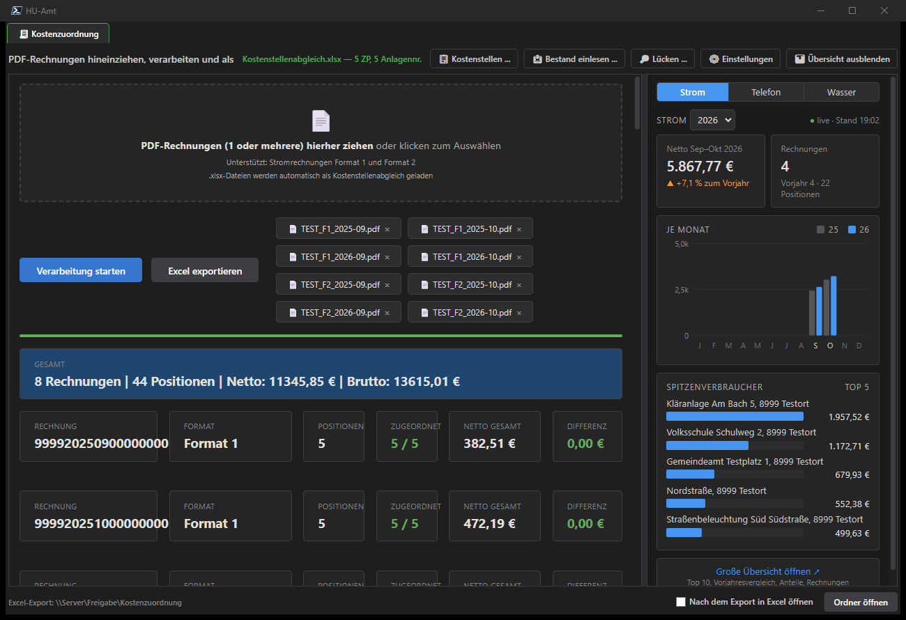
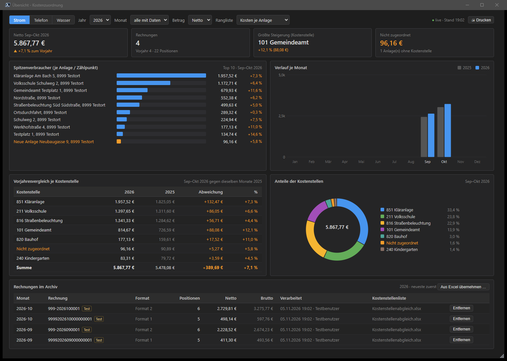
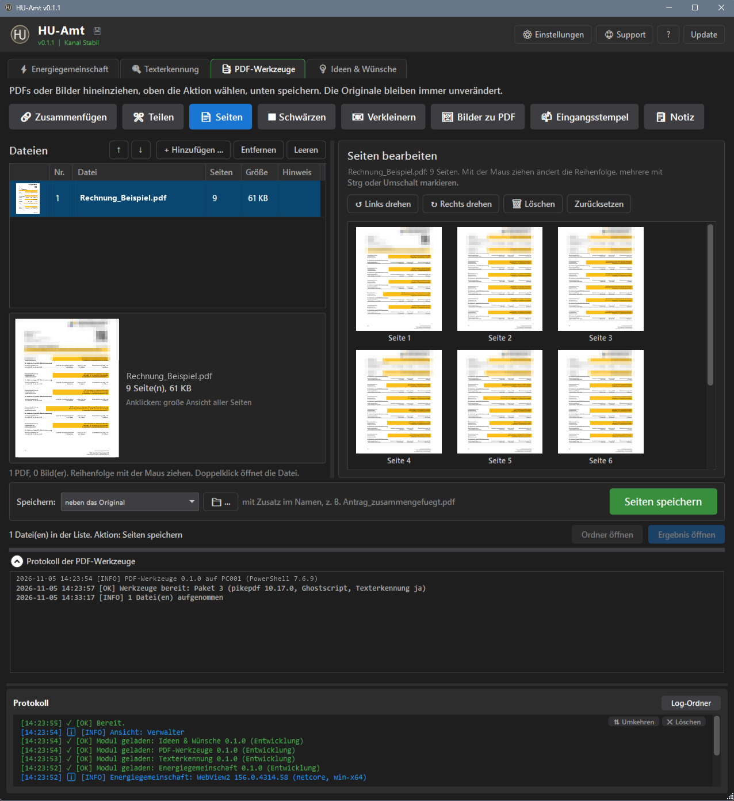
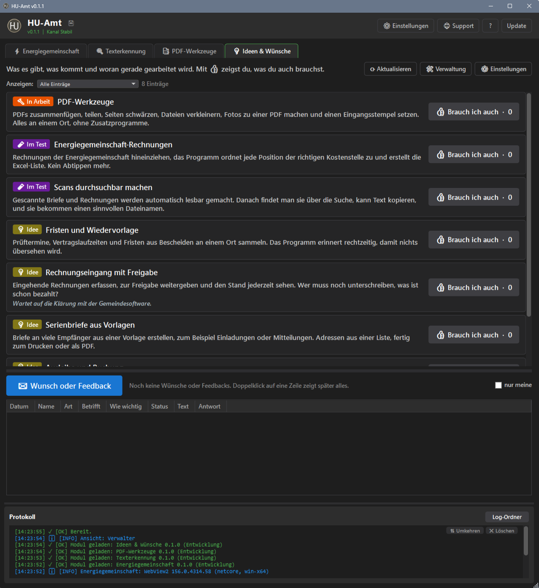

<h1 align="center"> HU-Amt</h1>

<b>Werkzeuge für die Gemeindeverwaltung – aus einem Fenster</b> 
Jeder Reiter ist ein Modul: mitgeliefert oder signiert aus einem eigenen Repository. Dazu Update per Knopf, verschlüsselte Sicherung aller Einstellungen, Hilfe mit F1 und dunkles Farbschema. 
Läuft ohne Installation aus einem Ordner am PC oder auf einer Netzfreigabe, für mehrere Bedienstete gleichzeitig.

  
  
  
  
  
  

  <a href="https://chiliapple.github.io/HU-Amt/Docs/Einstieg.html"><b>Einstieg</b></a> ·
  <a href="https://chiliapple.github.io/HU-Amt/Docs/Funktionen.html"><b>Funktionen</b></a> ·
  <a href="https://chiliapple.github.io/HU-Amt/Docs/Anleitung.html"><b>Anleitung</b></a> ·
  <a href="https://chiliapple.github.io/HU-Amt/Docs/Anleitung.html#installation">Installation</a> ·
  <a href="MODULE-DEVELOPMENT.md">Module entwickeln</a> ·
  <a href="CHANGELOG.md">Änderungen</a> ·
  <a href="LICENSE">Lizenz</a>

  
  
   
  
  
   Kostenzuordnung · Übersicht · PDF-Werkzeuge · Ideen &amp; Wünsche – mit Testdaten, zum Vergrößern anklicken

---

## Schnellstart

1. Einen neuen Ordner anlegen, auch auf einer Netzfreigabe, nur `Pull.ps1` hineinlegen und mit Rechtsklick › **Mit PowerShell ausführen** starten. HU-Amt kommt in genau diesen Ordner.
2. **Start-HU-Amt.cmd** → beim ersten Start Desktop-Symbol und Taskleiste wählen
3. Wer installiert, ist automatisch Verwalter (sonst fragt HU-Amt beim ersten Start). Dann die Zugangsdatei `*.humodule` ins Fenster ziehen. Weitere Verwalter unter **Einstellungen › Verwalter**.

Was das Programm kann und wie es geht:

- **[Einstieg](https://chiliapple.github.io/HU-Amt/Docs/Einstieg.html)** – typische Situationen aus dem Alltag
- **[Funktionen](https://chiliapple.github.io/HU-Amt/Docs/Funktionen.html)** – alles auf einer Seite
- **[Anleitung](https://chiliapple.github.io/HU-Amt/Docs/Anleitung.html)** – Schritt für Schritt; im Programm zeigt **F1** die Hilfe zum Reiter

---

## Was der Kern mitbringt

- **Module als Reiter:** Jedes Modul kommt signiert aus seinem eigenen Repository und wird über **Einstellungen › Module** oder eine Zugangsdatei hinzugefügt und aktualisiert. Module können Dateien untereinander weitergeben.
- **Für mehrere PCs auf einer Freigabe:** Daten liegen unter `Data\`, gespeichert wird mit Sperre, Stand-Prüfung und atomarem Schreiben. Ist die Freigabe kurz weg, meldet sich die App, statt leere Listen zu zeigen.
- **Outlook und Word:** Termine, Aufgaben und Mails (nur anzeigen, Absender wählbar) sowie Word-Vorlagen als PDF, alles über einen gemeinsamen Baustein. Word öffnet Vorlagen mit gesperrten Makros.
- **Sicherung und Update:** verschlüsselte Sicherung aller Einstellungen, signierte Updates von App und Modulen per Knopf.
- **Testmodus:** Verwalter probieren neue Module mit einem eigenen Testbestand aus, echte Daten bleiben unberührt; ein geführter Test protokolliert die Schritte.
- **Einheitliche Oberfläche:** dunkles Farbschema, Tooltips, verschiebbare Bereiche und Fenstergrößen bleiben erhalten, Hilfe mit **F1**.

## Rechte auf der Freigabe

Wer `Data\Verwalter.txt` ändern darf, kann sich selbst zum Verwalter machen. Empfehlung: `Data` mit **Ändern** für die Benutzer der App (ohne Vollzugriff), `Data\Verwalter.txt` nur **Lesen** für Benutzer und **Ändern** nur für Verwalter, Vererbung an dieser Datei unterbrochen. Unter **Einstellungen › Verwalter** zeigt HU-Amt eine Warnung, wenn die NTFS-Rechte zu breit sind. Freigaberechte (SMB) sieht die App nicht, die prüft der Administrator selbst. Details: [Module entwickeln › Rechte auf der Freigabe](MODULE-DEVELOPMENT.md#rechte-auf-der-freigabe).

## Module entwickeln

Gemeinsame Bausteine (Datenablage, Zahlen und Datum, Verlauf, Anhänge, PDF, Excel/CSV, Dialoge, Kalender, Hintergrund-Laden) und Vorlagen für Modul-Repositories liefert der Kern. Ein Modul enthält nur seine Fachlogik. Alles Nötige steht in [MODULE-DEVELOPMENT.md](MODULE-DEVELOPMENT.md).

---

**Lizenz:** kostenlose Nutzung erlaubt, eigene Module und Einstellungen ausdrücklich auch – Details in [LICENSE](LICENSE).
