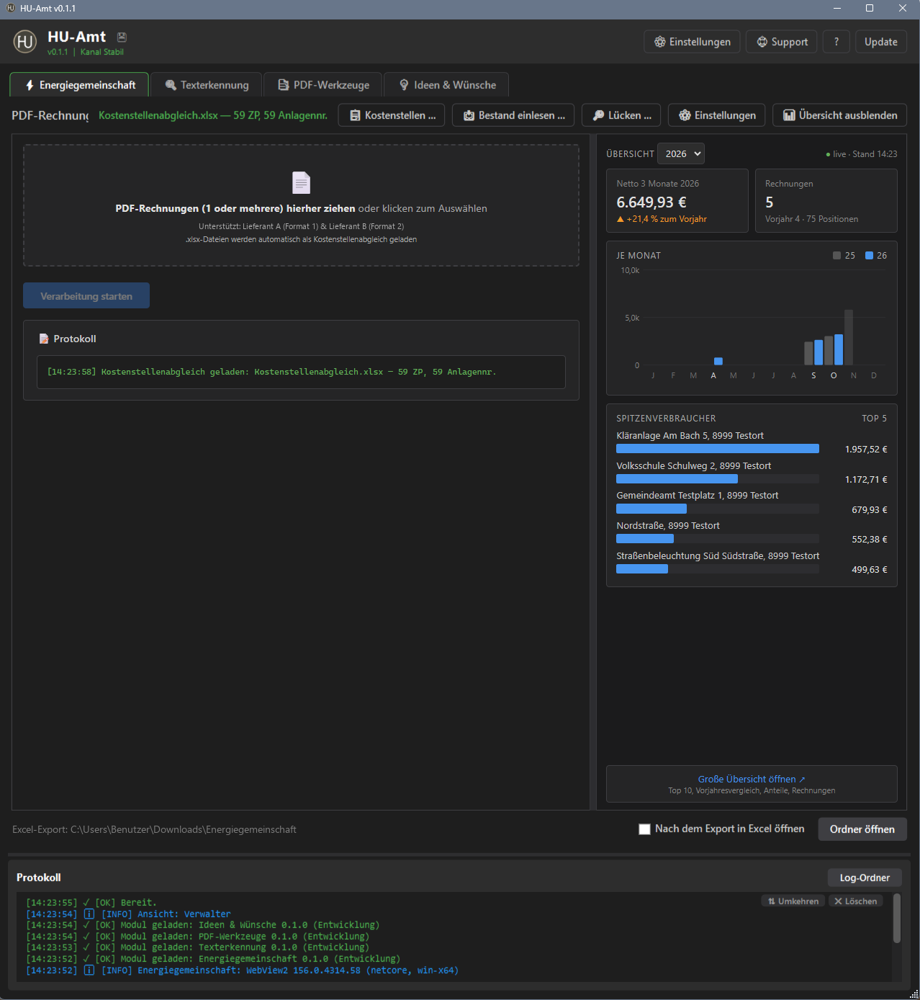

<h1 align="center"> HU-Amt</h1>

<b>Werkzeuge für die Gemeindeverwaltung – aus einem Fenster</b> 
Jeder Reiter ist ein Modul: mitgeliefert oder signiert aus einem eigenen Repository. Dazu Update per Knopf, verschlüsselte Sicherung aller Einstellungen, Hilfe mit F1 und dunkles Farbschema. 
Läuft ohne Installation aus einem Ordner am PC oder auf einer Netzfreigabe, für mehrere Bedienstete gleichzeitig.

  
  
  
  
  
  

  <a href="https://chiliapple.github.io/HU-Amt/Docs/Grundhilfe.html"><b>Hilfe</b></a> ·
  <a href="#installation">Installation</a> ·
  <a href="#auf-einer-netzfreigabe">Netzfreigabe</a> ·
  <a href="MODULE-DEVELOPMENT.md">Module entwickeln</a> ·
  <a href="CHANGELOG.md">Änderungen</a> ·
  <a href="LICENSE">Lizenz</a>

  
  
   
  
  
   Energiegemeinschaft · Übersicht · PDF-Werkzeuge · Ideen &amp; Wünsche – mit Testdaten, zum Vergrößern anklicken

---

## Was es kann

- **Module als Reiter:** Jedes Werkzeug ist ein eigener Reiter. Die Reiter lassen sich mit der Maus verschieben, die Reihenfolge bleibt gespeichert.
- **Dateien hineinziehen:** PDF- oder Excel-Dateien aufs Fenster ziehen, das passende Modul übernimmt sie. Module können Dateien auch an andere Module weitergeben.
- **Update per Knopf:** Programm und Module kommen als signierte Releases von GitHub. Jede Datei wird vor dem Ersetzen geprüft, bei einer Abweichung bleibt alles, wie es war.
- **Sicherung:** Einstellungen, Daten und Module werden verschlüsselt gesichert und lassen sich wiederherstellen.
- **Beim nächsten Start wie beim Schließen:** Fenster, Reiter und Einstellungen jedes Benutzers bleiben erhalten.
- **Ansichten:** Verwalter richtet ein, Bedienstete arbeiten.

## Installation

1. `Pull.ps1` in einen leeren Ordner legen, z. B. `C:\Tools\HU-Amt`, und ausführen:
   `powershell -ExecutionPolicy Bypass -File Pull.ps1`
2. **Start-HU-Amt.cmd** doppelklicken.
3. Beim ersten Start fragt das Programm, ob es eine Verknüpfung auf den Desktop oder in die Taskleiste legen soll.

Voraussetzungen: Windows 10 oder 11, Windows PowerShell 5.1 (vorhanden) oder PowerShell 7.

## Auf einer Netzfreigabe

- Den Ordner einmal auf die Freigabe legen. Jeder Benutzer startet `Start-HU-Amt.cmd` von dort und bekommt beim ersten Start die Frage nach der Verknüpfung.
- Daten liegen gemeinsam im Ordner `Data\`, Einstellungen und Zugangsdaten je Windows-Benutzer.
- Ein Update ersetzt nichts, solange jemand anderer das Programm offen hat.

## Module

- **Mitgeliefert** kommen sie mit dem Programm-Update.
- **Aus einem eigenen Repository** werden sie in der Modulverwaltung eingetragen, auch mehrere auf einmal über eine Zugangsdatei. Jede Fassung muss signiert sein.
- Wie man ein Modul baut: [MODULE-DEVELOPMENT.md](MODULE-DEVELOPMENT.md).

---

**Lizenz:** kostenlose Nutzung erlaubt, eigene Module und Einstellungen ausdrücklich auch – Details in [LICENSE](LICENSE).
